# Usage Metering & Billing Engine

[]()
[-blue.svg)]()
[-blueviolet.svg)]()
[-success.svg)]()
[](LICENSE)

A production-grade, multi-tenant SaaS usage metering and billing backend service. Meters billable events with exactly-once idempotency guarantees, enforces subscription quotas with explicit HTTP status codes (`429` vs. `402`), implements precise integer-based money math for complex AI token tiers, and synchronizes subscription state via cryptographically verified Stripe test webhooks.

---

## 1. System Architecture

```mermaid
flowchart TD
    subgraph MeteringPath["Usage Metering & Quota Enforcement Path"]
        Client["Client / API Consumer"] --> BillableReq["POST /api/meter or POST /api/generate\n(Header: Idempotency-Key)"]
        BillableReq --> IdempCheck{"Idempotency Check\n(idempotency_records Table)"}
        IdempCheck -- "Key Exists (Replay)" --> CachedResp["Return Original Response\n(is_idempotent_replay: true, No DB Write)"]
        
        IdempCheck -- "New Key" --> QuotaGate{"Pre-Action Quota Check"}
        QuotaGate -- "Status: past_due / canceled" --> Err402["402 Payment Required\n(Subscription Delinquent)"]
        QuotaGate -- "Used + Requested > Limit" --> Err429["429 Too Many Requests\n(Retry-After: 3600s)"]
        
        QuotaGate -- "Allowed (Within Quota)" --> MoneyCalc["Integer Money Math\n(Cached Discount + Reasoning as Output)"]
        MoneyCalc --> StoreEvent[("Store usage_events\n& idempotency_records")]
        StoreEvent --> Success201["201 Created\n(Metered Event & Cost)"]
    end

    subgraph ReadPath["Usage Aggregation & Reporting Path"]
        GetUsage["GET /api/usage?tenant_id=..."] --> Rollup["Rollup Service\n(Sum Events in Current Period)"]
        Rollup --> RespUsage["UsageRollupResponse\n(used, quota, remaining, cost in microcents)"]
    end

    subgraph StripePath["Stripe Subscription & Webhook Sync Path"]
        CheckoutReq["POST /api/billing/checkout-session"] --> StripeCheckout["Create Test Session\n(cs_test_...)"]
        StripeWebhook["POST /api/webhooks/stripe\n(Header: Stripe-Signature)"] --> HMACCheck{"Cryptographic HMAC-SHA256\nSignature Verification"}
        HMACCheck -- "Invalid / Forged Signature" --> Err400["400 Bad Request\n(Signature Mismatch)"]
        HMACCheck -- "Valid Signature" --> DedupCheck{"Replay Deduplication\n(processed_stripe_events Table)"}
        DedupCheck -- "Event Already Processed" --> Skip200["200 OK\n(status: already_processed)"]
        DedupCheck -- "New Event" --> ApplyEvent["Sync Tenant Plan\n(checkout.session.completed -> Flip to Pro)\n(customer.subscription.deleted -> Downgrade Free)"]
    end
```



---

## 2. Subscription Plans & Quotas

| Plan Tier | Monthly API Calls Quota | Monthly AI Tokens Quota | Base Price | Target Customer |
| :--- | :---: | :---: | :---: | :--- |
| **Free Tier** | **1,000 calls** | **100,000 tokens** (100k) | $0.00 / mo | Hobbyists, developers testing integrations |
| **Pro Tier** | **50,000 calls** | **10,000,000 tokens** (10M) | $29.00 / mo (2,900 cents) | Growing startups, automated production agents |

---

## 3. Pinned AI Token Pricing Rules & Money Math

To prevent IEEE-754 binary floating-point rounding errors, all internal financial accounting is stored as **integer microcents** ($1\text{ USD} = 100\text{ cents} = 100,000,000\text{ microcents}$).

$$\text{Total Cost} = (\text{input\_tokens} \times P_{\text{in}}) + (\text{cached\_input\_tokens} \times P_{\text{cached}}) + ((\text{output\_tokens} + \text{reasoning\_tokens}) \times P_{\text{out}})$$

| Token Classification | Rate per 1,000,000 Tokens | Microcents / Token | Rule Description |
| :--- | :---: | :---: | :--- |
| **Fresh Input Tokens** | **$0.150** | 15 microcents | Standard prompt input tokens |
| **Cached Input Tokens** | **$0.075** | 7.5 microcents | **50% Discount** for cached context prefixes |
| **Output Tokens** | **$0.600** | 60 microcents | Generated completion tokens |
| **Reasoning Tokens** | **$0.600** | 60 microcents | **Billed as Output Tokens** (never unmetered or free) |

---

## 4. Quickstart & Verification Commands

### 4.1 Setup & Installation
```bash
git clone https://github.com/jezreal-dev/flyrank-capstone-metering-billing.git
cd flyrank-capstone-metering-billing

# Install standard dependencies (Python 3.10+)
pip install -r requirements.txt
```

### 4.2 Seed Plans & Benchmark Tenants
```bash
python scripts/seed_data.py
```
Initializes the SQLite database with WAL mode and seeds default plans (`free`, `pro`) and test tenants (`tenant_alpha`, `tenant_beta`, `tenant_boundary`, `tenant_delinquent`).

### 4.3 Run Service
```bash
python -m uvicorn app.main:app --host 0.0.0.0 --port 8000
```
- Swagger Documentation: `http://localhost:8000/docs`
- Health check: `http://localhost:8000/health`

### 4.4 Run Test Suite & Acceptance Probes
```bash
# Run 30 automated Pytest tests
pytest

# Run all 5 Evaluator Acceptance Probes
python scripts/verify_probes.py
```

---

## 5. API Endpoints Reference

| Route | Method | Header | Description |
| :--- | :--- | :--- | :--- |
| `/health` | `GET` | - | Health check and SQLite WAL status |
| `/api/plans` | `GET` | - | Query available tiers and limits |
| `/api/meter` | `POST` | `Idempotency-Key` | Idempotent billable usage event recording |
| `/api/generate` | `POST` | `Idempotency-Key` | Dummy billable AI generation endpoint |
| `/api/usage` | `GET` | - | Monthly usage rollup, quotas, and incurred costs |
| `/api/billing/checkout-session` | `POST` | - | Initiate Stripe Checkout session for Pro upgrade |
| `/api/webhooks/stripe` | `POST` | `Stripe-Signature` | Cryptographically verified, deduplicated webhook handler |

---

## 6. Known Limitations & Production Roadmap

1. **Local Single-Node Idempotency Store**:
   - The current idempotency deduplication cache is stored in SQLite with transactional row locking. For multi-region globally distributed clusters, migrating the idempotency lock to Redis with `SET key val NX EX 86400` would enable sub-millisecond distributed deduplication.
2. **Monthly Rollup Window**:
   - Usage events roll up based on the tenant's current billing cycle start timestamp. Adding pre-aggregated hourly and daily rollup materialized tables would accelerate analytics for tenants with millions of daily API calls.
3. **Proration Mechanics**:
   - The core implementation switches plan quotas immediately upon webhook confirmation (`checkout.session.completed`). Complex mid-cycle proration credit calculations are handled via Stripe's native invoice proration engine.
